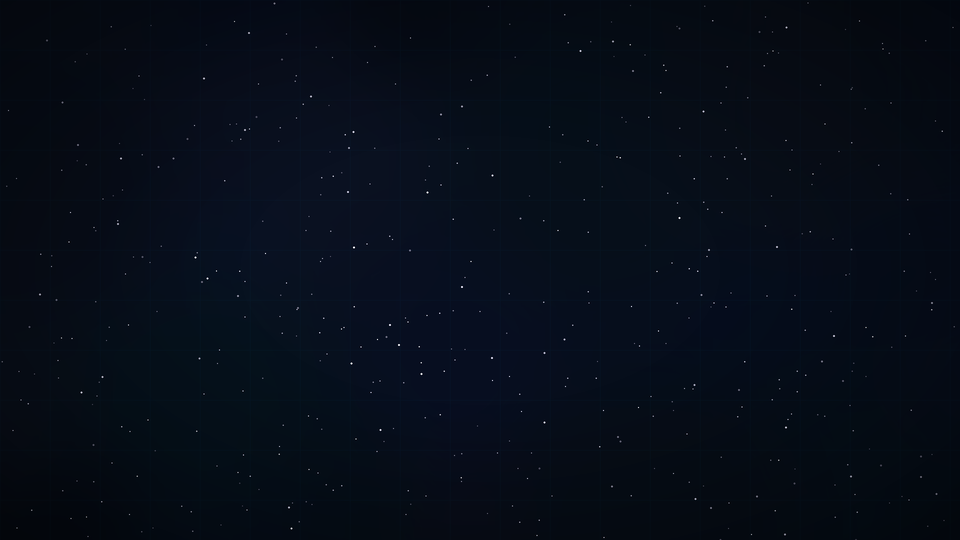

#+AUTHOR: Pierre Étienne Charles Schebath CAZOULAT akka
#+DATE: <2026-10-31 sam..>
#+EMAIL: contact@lugtech.fr

:PROPERTIES:
:project-name: Star-Trek-Unofficial
:github-project: [[https://github.com/Glider-P90/Star-Trek-Unofficial][Retrouvez le projet sur GitHub]]
:project-version: 0.1
:END:

* Star Trek Unofficial

** Présentation

Thème KDE Plasma Star Trek non-officiel, inspiré du bridge de l'USS Enterprise.

#+CAPTION: Preview du wallpaper
#+ATTR_ORG: :width 60%

** Palette

| Rôle        | Couleur         | Hex      |
|-------------+-----------------+----------|
| Fond        | Espace profond  | =#060b15= |
| Panneaux    | Console bridge  | =#0d1b2a= |
| Texte       | Affichage holo  | =#c8e6ff= |
| Accent      | Glow cyan       | =#00d4ff= |
| Highlight   | Or Enterprise   | =#ffb700= |
| Alert       | Red alert       | =#ff3333= |
| Success     | Canal vert      | =#00e676= |

** Structure

#+BEGIN_EXAMPLE
Star-Trek-Unofficial/
├── theme.yaml              # Descripteur du thème Plasma
├── colors/
│   └── StarTrek.colors     # Color scheme (format KDE)
├── wallpapers/
│   └── starpac/
│       ├── wallpaper.png   # 1920x1080 deep space
│       ├── preview.png     # 960x540 preview
│       └── metadata.json   # Metadata wallpaper
├── tools/
│   └── img-to-multi-resolution.sh  # Génération multi-res (ImageMagick)
├── gen_wallpaper.py        # Générateur procédural (Pillow + NumPy)
└── LICENSE                 # CC BY-NC 4.0
#+END_EXAMPLE

** Installation

*** Thème complet (color scheme + wallpaper)

#+BEGIN_SRC bash
# Color scheme
mkdir -p ~/.local/share/color-schemes
cp colors/StarTrek.colors ~/.local/share/color-schemes/

# Wallpaper
mkdir -p ~/.local/share/wallpapers
cp -r wallpapers/starpac ~/.local/share/wallpapers/
#+END_SRC

Puis dans ~Paramètres du système → Apparence → Couleurs~, sélectionner ~StarTrek~.

*** Wallpaper uniquement

#+BEGIN_SRC bash
mkdir -p ~/.local/share/wallpapers
cp -r wallpapers/starpac ~/.local/share/wallpapers/
#+END_SRC

Clic droit sur le bureau → Changer de fond d'écran → ~starpac~.

*** Multi-résolutions (ImageMagick)

#+BEGIN_SRC bash
# Adapter le chemin SRC dans le script vers ton image source
sudo bash tools/img-to-multi-resolution.sh
#+END_SRC

** Régénérer le wallpaper procédural

#+BEGIN_SRC bash
pip install Pillow numpy
python3 gen_wallpaper.py
#+END_SRC

Le wallpaper est généré procéduralement — aucun asset copyrighté.

** À savoir

- Thème en cours de développement...
- Thème de fan ~non-officiel~. Non affilié à CBS, Paramount ou la franchise Star Trek.
- Icon theme : ~Breeze~ (défaut KDE) par défaut. Un set d'icônes Star Trek custom peut être ajouté.
- Window decoration : ~Default~ par défaut. Une decoration KWin custom peut être ajoutée.

** Copyright

Copyright © 2025 Pierre Schebath (alias Glider)

Cette œuvre est sous licence Creative Commons Attribution -
Pas d'Utilisation Commerciale 4.0 International (CC BY-NC 4.0).

Vous êtes libre de :
- Partager — copier et redistribuer le matériel sur tout support ou sous tout format
- Adapter — remixer, transformer et créer à partir du matériel

À condition que l'utilisation ne soit pas commerciale.

** Contact

Email: contact@lugtech.fr
